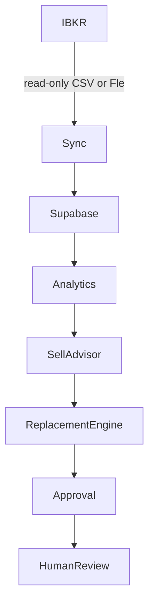

# Portfolio Intelligence Platform Architecture

## Phase 1 findings

StockScanner is a Python 3.11 package (`stockscanner/`) for market-data collection,
screening, scoring, and report generation. Its static HTML/JavaScript pages live at
the repository root and use Supabase Auth and RLS for user-specific features.
`portfolio-analysis.html` and `portfolio-analysis.js` support IBKR CSV/Flex imports,
while `portfolio-recovery.js` contains the existing portfolio review and recovery
logic. `portfolio.py` is an existing portfolio reporting entry point and remains
outside the PIP implementation.

Supabase is used by Python stores, static pages, Edge Functions, and SQL migrations.
`portfolio-signals` provides approved-user technical signals and
`portfolio-history` fetches history only after checking the caller's access and
holding ownership. The migration `20260828120000_add_user_portfolio_imports.sql`
owns imported positions in `user_portfolio_holdings` and import metadata in
`user_portfolio_imports`; `replace_my_portfolio_holdings` atomically replaces one
user's import. `price_snapshots` is scanner market data, not a portfolio-specific
history store. The established approval model is `auth.users` plus
`public.user_access.status = 'approved'`.

PIP belongs in the independent `stockscanner/pip/` package and additive
migrations. Existing scanner discovery and workflows remain unchanged; the
Portfolio Intelligence page is now an API client. Python package discovery
includes `stockscanner*` so the PIP subpackage and API are present in built
distributions. Runtime dependencies are listed in `pyproject.toml` and
`requirements.txt`.
Pytest and the Node test runner are the existing validation tools. The site
deployment workflow runs both test suites before publishing.

## Data ownership decisions

| Requested entity | Decision | Reason |
| --- | --- | --- |
| `users` | Reuse `auth.users`; use a minimal `pip_profiles` row only for optional PIP metadata | Avoid duplicating authentication identities, email, passwords, or approval status. The profile ID must equal `auth.users.id`. |
| `portfolios` | Create | No canonical portfolio container exists; ownership references `auth.users`. |
| `ibkr_accounts` | Create | Persist a masked display identifier and non-display fingerprint for stable multi-account linking; never persist credentials or an unmasked account number. |
| `positions` | Extend/reuse by ingestion, not table mutation | Continue accepting existing CSV/Flex imports; keep the existing import tables untouched and store normalized PIP snapshots separately. |
| `transactions` | Create | No normalized transaction ledger exists. |
| `dividends` | Create | The existing CSV holding import does not store cash-dividend events. |
| `daily_snapshots` | Create | `price_snapshots` is a singleton market-price cache and cannot represent a per-user, per-symbol time series. |
| `analyst_signals` | Create | Keep analyst/revision inputs separate from scanner and catalyst datasets. |
| `stock_scores` | Create | Scanner scores and portfolio-specific CPS/Sell Score inputs have different meaning and lifecycles. |
| `sell_recommendations` | Create | Existing portfolio signals are screening outputs, not durable, auditable approval records. |
| `replacement_candidates` | Create | No persisted, portfolio-aware candidate ranking exists. |
| `audit_logs` | Create | Existing recommendation state does not provide an append-only PIP transition history. |
| Approval state | Extend conceptually, store separately | Reuse sell/partial-sell/hold decision concepts, but keep PIP's explicit review states and audit trail separate from existing scanner workflows. |

## Data flow

Human review records a decision; it does not transmit an order. Sync is read-only
and accepts fixtures, CSV exports, and optional live XML Flex statements retrieved
by the server-only Supabase Edge Function. Each approved user can manage multiple
Flex connections and portfolios. Credentials live in Supabase Vault; the browser
never receives them. Analytics and scoring are deterministic Python functions
with explicit missing-data confidence. All recommendations are advisory
screening prompts and require a separately recorded human approval.

The deployable FastAPI service is `stockscanner.pip.api:app` (console command
`stockscanner-pip-api`). Each request authenticates its bearer token with Supabase
Auth, requires approved `user_access`, and uses the same token for PostgREST so
table RLS remains active. The service never uses a service-role key. The API
integrates lifecycle, dead-money, opportunity-cost, dividend, growth,
forward-looking, scoring, recommendation, and approval modules. The browser page
uses the signed-in Supabase access token only for API requests; its configured API
URL is stored locally and never contains credentials. Flex tokens and Query IDs
are submitted only to the API and saved through restricted Vault RPCs; the API
uses the caller JWT for portfolio persistence and does not receive the
service-role key.

Approval state and its audit event are persisted in one owner-checked database
function. `approved_by` stores `auth.uid()` as a UUID; the reviewer label remains
separate audit detail. Authenticated clients cannot directly update
recommendation status or insert audit events. The API records approval only and
does not submit orders.

## Risks and controls

- **Cross-user data access:** enable RLS on every PIP table; authorization requires
  the authenticated owner and an approved `user_access` record.
- **Duplicate or sensitive identity data:** key PIP profile references to
  `auth.users`; never copy passwords or tokens. Do not persist or log raw IBKR
  account identifiers; store only a masked value and stable one-way fingerprint
  when needed.
- **Market data is not a position ledger:** do not reuse `price_snapshots` for
  per-position daily snapshots.
- **Missing or stale inputs:** omit missing score components from the weighted
  mean, return explicit reasons, and lower the result's confidence.
- **Order execution risk:** do not implement network transmission. Approval alone
  only advances workflow state; any future execution integration needs a separate
  feature-flagged, non-CI design review.
- **Migration drift:** apply the account-fingerprint and Vault-backed Flex
  migrations after the PIP core and approval migrations. Never alter existing
  scanner portfolio imports or RPCs.
