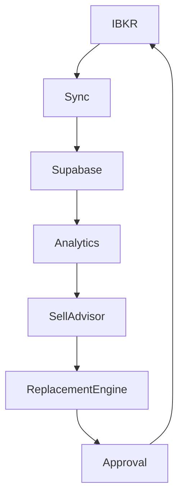

# Portfolio Intelligence Platform Architecture

## Phase 1 findings

StockScanner is a Python 3.11 package (`stockscanner/`) for market-data collection,
screening, scoring, and report generation. Its static HTML/JavaScript pages live at
the repository root and use Supabase Auth and RLS for user-specific features.
`portfolio-analysis.html` and `portfolio-analysis.js` support IBKR CSV/Flex imports,
while `portfolio-recovery.js` contains the existing portfolio review and recovery
logic. `portfolio.py` is an existing portfolio reporting entry point and remains
outside the PIP implementation.

Supabase is used by Python stores, static pages, Edge Functions, and SQL migrations.
`portfolio-signals` provides approved-user technical signals and
`portfolio-history` fetches history only after checking the caller's access and
holding ownership. The migration `20260828120000_add_user_portfolio_imports.sql`
owns imported positions in `user_portfolio_holdings` and import metadata in
`user_portfolio_imports`; `replace_my_portfolio_holdings` atomically replaces one
user's import. `price_snapshots` is scanner market data, not a portfolio-specific
history store. The established approval model is `auth.users` plus
`public.user_access.status = 'approved'`.

PIP belongs in the independent `stockscanner/pip/` package and new migrations,
without modifying scanner discovery, static pages, Edge Functions, or existing
tests. Python package discovery must include `stockscanner*` so the PIP subpackage
is present in built distributions. Existing declared runtime dependencies are
listed in `pyproject.toml`; `requirements.txt` is the deployment install list.
Pytest and the Node test runner are the existing validation tools. The site
deployment workflow runs both test suites before publishing.

## Data ownership decisions

| Requested entity | Decision | Reason |
| --- | --- | --- |
| `users` | Reuse `auth.users`; use a minimal `pip_profiles` row only for optional PIP metadata | Avoid duplicating authentication identities, email, passwords, or approval status. The profile ID must equal `auth.users.id`. |
| `portfolios` | Create | No canonical portfolio container exists; ownership references `auth.users`. |
| `ibkr_accounts` | Create | Existing imports retain broker labels only; persist a masked identifier, never credentials or an unmasked account number. |
| `positions` | Extend/reuse by ingestion, not table mutation | Continue accepting existing CSV/Flex imports; keep the existing import tables untouched and store normalized PIP snapshots separately. |
| `transactions` | Create | No normalized transaction ledger exists. |
| `dividends` | Create | The existing CSV holding import does not store cash-dividend events. |
| `daily_snapshots` | Create | `price_snapshots` is a singleton market-price cache and cannot represent a per-user, per-symbol time series. |
| `analyst_signals` | Create | Keep analyst/revision inputs separate from scanner and catalyst datasets. |
| `stock_scores` | Create | Scanner scores and portfolio-specific CPS/Sell Score inputs have different meaning and lifecycles. |
| `sell_recommendations` | Create | Existing portfolio signals are screening outputs, not durable, auditable approval records. |
| `replacement_candidates` | Create | No persisted, portfolio-aware candidate ranking exists. |
| `audit_logs` | Create | Existing recommendation state does not provide an append-only PIP transition history. |
| Approval state | Extend conceptually, store separately | Reuse sell/partial-sell/hold decision concepts, but keep PIP's explicit review states and audit trail separate from existing scanner workflows. |

## Data flow

The final edge describes a human's optional action outside this service. PIP has no
order-transmission implementation. Sync is read-only and accepts a pluggable source,
including fixtures and the existing CSV/Flex export format. Analytics and scoring
are deterministic Python functions with explicit missing-data confidence. All
recommendations are advisory screening prompts and require a separately recorded
human approval.

## Risks and controls

- **Cross-user data access:** enable RLS on every PIP table; authorization requires
  the authenticated owner and an approved `user_access` record.
- **Duplicate or sensitive identity data:** key PIP profile references to
  `auth.users`; never copy passwords or tokens. Do not persist or log raw IBKR
  account identifiers; store only a masked value when needed.
- **Market data is not a position ledger:** do not reuse `price_snapshots` for
  per-position daily snapshots.
- **Missing or stale inputs:** omit missing score components from the weighted
  mean, return explicit reasons, and lower the result's confidence.
- **Order execution risk:** do not implement network transmission. Approval alone
  only advances workflow state; any future execution integration needs a separate
  feature-flagged, non-CI design review.
- **Migration drift:** apply the new PIP migration after the existing user approval
  and portfolio-import migrations. Never alter existing portfolio tables or RPCs.

